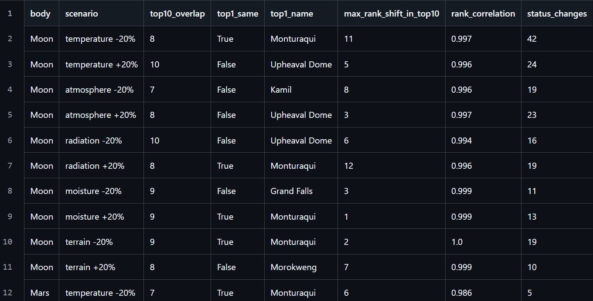

# Earth Analog Finder

**[Parallex] | [Alex vega]**
NASA Space Apps Challenge: *Identify Earth Locations that Analog the Permanent Moon Base Locations and Mars*

> Find the places on Earth that come closest to the Moon and Mars. Compare 187 sites, see which ones are recommended for testing, and spot the warnings before you go.

---

## Overview

Earth Analog Finder helps teams find places on Earth that are most like the Moon and Mars. It compares **187 Earth locations** with the average Moon and Mars conditions, ranks every location, and shows which ones are recommended as test sites and which are not.

## Features

- Choose **Moon** or **Mars** as the target body.
- See the **top 10** sites, or the **full ranked list** of all 187.
- Open a site to see its score, status, conditions and any warnings.
- Sites that are not recommended are clearly marked.


*Figure 6. App screenshots*

## Data


| Dataset | Source |
|---|---|
| Earth locations | USGS — [(https://earthexplorer.usgs.gov/)] |
| Moon and Mars reference | One row of average conditions per body. |

Each Earth location has **10 conditions**: average, maximum and minimum temperature, pressure, wind, solar radiation, UV index, humidity, rainfall and elevation. Almost all locations are impact craters.

### Data cleaning

- Fixed the Moon/Mars labels (spelling, spaces and one typo) and removed an empty column.
- Merged 5 sites that were listed twice, taking the data from 192 to **187 locations**. Two different places that share a name (Ritland) were kept apart.
- Put both tables on the same units: solar radiation in **W/m²** and pressure in **kPa**.


*Figure 1. Earth locations data before cleaning*


*Figure 2. Earth locations data after cleaning*

## How It Works

The app uses a **k-nearest-neighbours (kNN)** approach: the closer a site's conditions are to the Moon or Mars, the better the match.

1. **Scale.** Every condition is measured against the typical Earth value, and extreme values are capped so no single condition decides the result.
2. **Weight.** Temperature 30%, atmosphere 25%, radiation 25%, moisture 15%, terrain 5%.
3. **Measure.** The weighted distance from every Earth site to the Moon, and to Mars, is calculated. Smaller is closer.
4. **Rank and label.** All 187 sites are ranked:
   - Within 10% of the best distance → **Recommended**
   - Within 20% → **Acceptable**
   - Further → **Not recommended**
5. **Warn.** A site that matches well overall but is among the weakest sites on a condition gets a *caution* or *high* warning.

## Results

**Monturaqui** is the closest site for both the Moon and Mars. No Earth site matches either body exactly, so the list shows the closest Earth can offer.

| Rank | Closest to the Moon | Closest to Mars |
|---|---|---|
| 1 | Monturaqui | Monturaqui |
| 2 | Grand Falls | Kara-Kul |
| 3 | Upheaval Dome | Carancas |
| 4 | Morokweng | Gweni-Fada |
| 5 | Saqqar | Sierra Madera |

- **Moon:** 107 usable sites (54 Recommended, 53 Acceptable). Not recommended starts at rank 108.
- **Mars:** 48 usable sites (3 Recommended, 45 Acceptable). Not recommended starts at rank 49.


*Figure 3. Ranked results*

## Validation

The weights are a judgement call, so each weight group was moved down and up by 20% (10 tests per body) and all sites were re-ranked to see whether the answer changes.

- The overall ranking barely moves (correlation **0.985 or higher**).
- The top 10 shifts at its edges: at worst **7 of the original 10** sites stay, so the top 10 is sensitive to the weights.
- **Mars:** the #1 site never changes. **Moon:** the #1 site stays the same in 4 of 10 tests.
- Six sites per body stay in the top 10 in every test, so they are the safest picks:
  - **Moon:** Monturaqui, Grand Falls, Upheaval Dome, Morokweng, Saqqar, Kamil
  - **Mars:** Monturaqui, Kara-Kul, Carancas, Sierra Madera, Barringer (= Meteor), Grand Falls


*Figure 4. How each site's rank changed across the weight tests*


*Figure 5. Validation summary for every test*

## Limitations

- Earth never reaches the Moon's or Mars's extremes in temperature, pressure and UV, so results show the closest match, not an equal one. The Moon and Mars lists also overlap.
- The weights and the 10% / 20% cutoffs are our own choices and can be adjusted.
- Almost every site is an impact crater, so comparing different terrain types is not meaningful.

## Getting Started

<!-- Add setup and run instructions here, e.g. install steps, how to launch the app. -->

```bash
# [Add install and run commands]
```

## Team

<!-- [Team name] — add members and roles. -->

## Acknowledgements

- NASA Space Apps Challenge
- USGS for the Earth location data
