<h1 align="center">Parallax</h1>

<p align="center">
  <b>Analog Site Finder</b><br>
  Earth's closest training grounds for the Moon and Mars.
</p>

<p align="center">
  
  
  
</p>

<p align="center">
  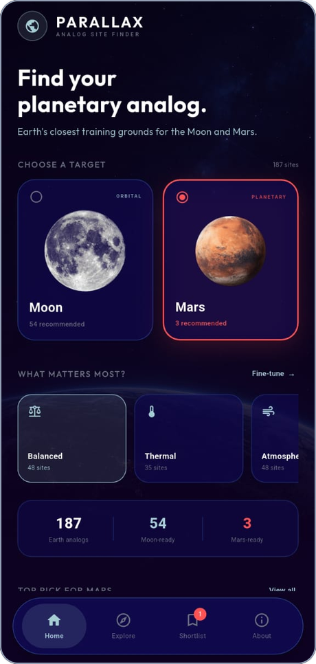
  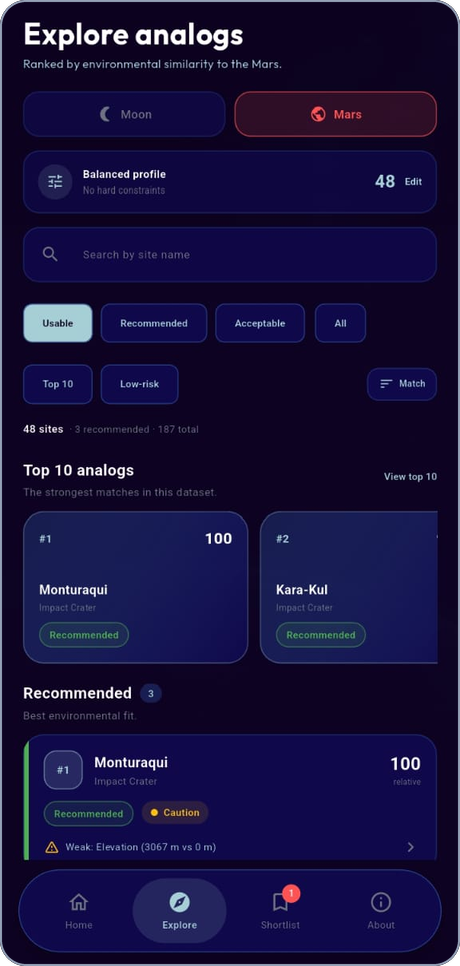
  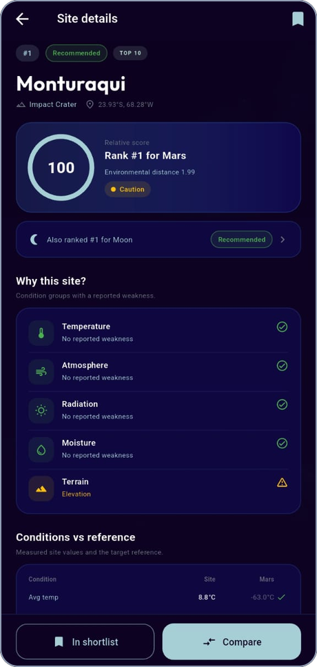
</p>

> Built for the **NASA Space Apps Challenge**: *Identify Earth Locations that Analog the Permanent Moon Base Locations and Mars.*

---

## Table of Contents

- [Overview](#overview)
- [App Features](#app-features)
- [App Screenshots](#app-screenshots)
- [Data Sources](#data-sources)
- [Data Cleaning](#data-cleaning)
- [How It Works](#how-it-works)
- [Results](#results)
- [Validation](#validation)
- [Limitations](#limitations)
- [Repository Structure](#repository-structure)
- [Getting Started](#getting-started)
- [Output Format](#output-format)
- [Team](#team)
- [Acknowledgements](#acknowledgements)

---

## Overview

Researchers use *analog sites* (places on Earth whose environment resembles another world) to train crews, test equipment and study geology before a mission.

**Parallax** compares 187 Earth locations with the average Moon and Mars conditions, ranks every location, and shows which ones are recommended as test sites and which are not. Each site gets a similarity score, a status (Recommended, Acceptable or Not recommended) and a warning when it matches well overall but is weak on a specific condition.

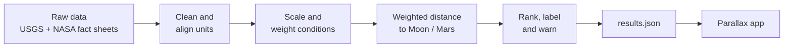
## App Repository: https://github.com/abdon2006/parallax

## App Features

- **Choose a target.** Pick the Moon or Mars. 54 Moon sites and 3 Mars sites are recommended.
- **Set priorities.** Pick a profile, then fine-tune the conditions you cannot compromise on. Sites weak in them are hidden.
- **Explore.** Search by site name and filter by Usable, Recommended, Acceptable, Top 10 or Low-risk.
- **Inspect a site.** See its score, status, warnings and each condition against the Moon or Mars value.
- **Shortlist and compare.** Compare up to 3 sites, with a suggested primary, backup and lowest-risk pick, and generate a mission brief.
- **Learn how it works.** The About screen explains analog sites, the score weights and the data sources.

## App Screenshots

<table align="center">
  <tr>
    <td align="center"><br><b>Home</b></td>
    <td align="center"><br><b>Explore</b></td>
    <td align="center"><br><b>Site details</b></td>
  </tr>
  <tr>
    <td align="center">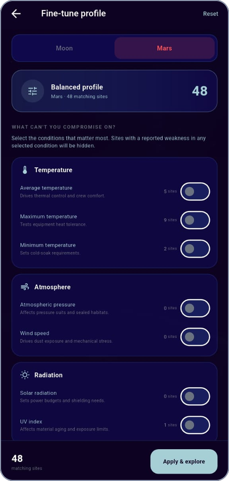<br><b>Fine-tune profile</b></td>
    <td align="center">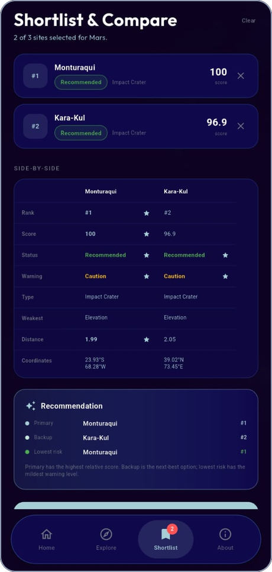<br><b>Shortlist &amp; Compare</b></td>
    <td align="center">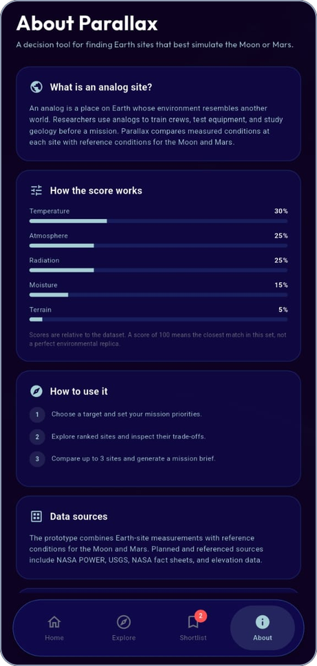<br><b>About</b></td>
  </tr>
</table>

## Data Sources

| Data | Source |
|---|---|
| Earth locations | [USGS](https://pubs.usgs.gov/of/2006/1168) |
| Moon and Mars reference conditions | [NASA planetary fact sheets](https://nssdc.gsfc.nasa.gov/planetary/factsheet/marsfact.html) |

Each Earth location has **10 conditions**: average, maximum and minimum temperature, pressure, wind, solar radiation, UV index, humidity, rainfall and elevation. Almost all of the locations are impact craters. The Moon and Mars each have one row of average conditions.

## Data Cleaning

The raw Earth data had 192 records and went through these steps:

- Fixed the Moon/Mars labels (spelling, spaces and one typo) and removed an empty column.
- Merged 5 sites that were listed twice, taking the data from **192 to 187 locations**. Two different places that shared a name (Ritland) were kept apart.
- Put both tables on the same units: solar radiation in W/m² and pressure in kPa.

| Before cleaning | After cleaning |
|---|---|
| 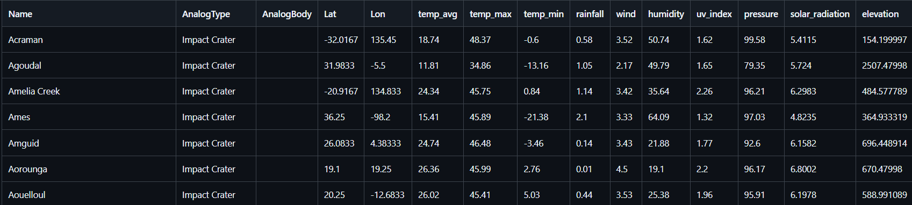 | 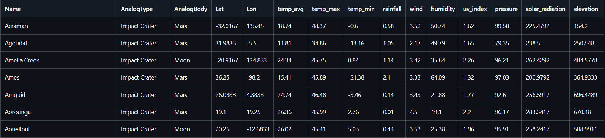 |

## How It Works

Parallax uses a weighted **k-nearest-neighbours (kNN)** approach: the closer a site's conditions are to the Moon or Mars, the better the match.

1. **Scale.** Every condition is measured against the typical Earth value (median and IQR), and extreme values are capped at ±3 so no single condition decides the result.
2. **Weight.** Conditions are grouped and weighted by importance.
3. **Measure.** The weighted distance from every Earth site to the Moon, and to Mars, is calculated. Smaller is closer.
4. **Rank and label.** All 187 sites are ranked and given a similarity score (`100 × best distance ÷ site distance`, so the best site scores 100).
5. **Warn.** A site that matches well overall but is among the weakest sites on a condition gets a warning.

### Weights

| Group | Conditions | Weight |
|---|---|---|
| Temperature | average, maximum, minimum | 30% |
| Atmosphere | pressure, wind | 25% |
| Radiation | solar radiation, UV index | 25% |
| Moisture | humidity, rainfall | 15% |
| Terrain | elevation | 5% |

A group's weight is split equally between its conditions.

### Status and warnings

| Status | Rule |
|---|---|
| Recommended | Distance within 10% of the best site |
| Acceptable | Distance within 20% of the best site |
| Not recommended | Anything further |

A usable site gets a **caution** warning when it is in the worst 15% of all sites on a condition in one group, and a **high** warning when this happens in two or more groups.

### Sanity check

To check that the distance measure is meaningful, each Earth site's Moon/Mars label is hidden and guessed from its nearest neighbours. This is correct about **81-85%** of the time (K = 3 to 11), against 55.6% for always guessing the majority label.

## Results

Monturaqui is the closest site for both the Moon and Mars. No Earth site matches either body exactly, so the list shows the closest Earth can offer.

| Rank | Closest to the Moon | Closest to Mars |
|---|---|---|
| 1 | Monturaqui | Monturaqui |
| 2 | Grand Falls | Kara-Kul |
| 3 | Upheaval Dome | Carancas |
| 4 | Morokweng | Gweni-Fada |
| 5 | Saqqar | Sierra Madera |

| | Recommended | Acceptable | Not recommended from |
|---|---|---|---|
| **Moon** | 54 | 53 | rank 108 |
| **Mars** | 3 | 45 | rank 49 |

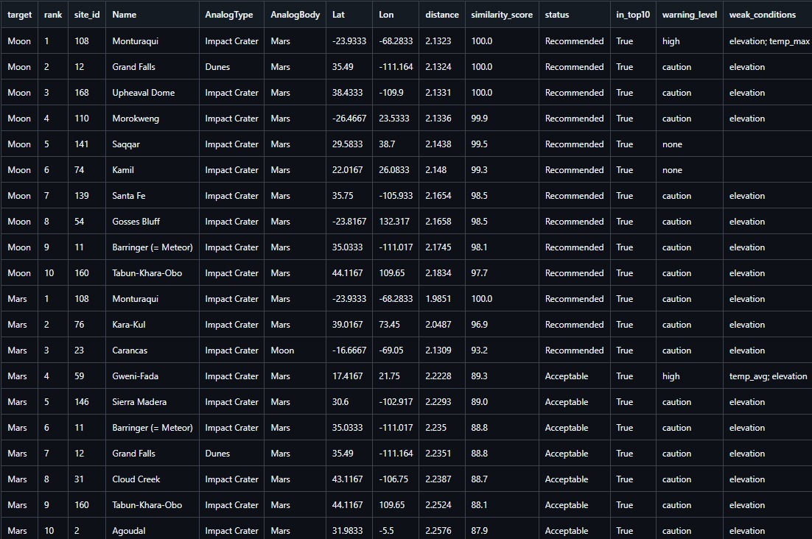

## Validation

The weights are a judgement call, so each weight group was moved down and up by 20% (10 tests for each body) and all sites were re-ranked to see whether the answer changes.

- The overall ranking barely moves (correlation 0.985 or higher).
- The top 10 shifts at its edges: at worst 7 of the original 10 sites stay, so the top 10 is sensitive to the weights.
- **Mars:** the #1 site never changes. **Moon:** the #1 site stays the same in 4 of 10 tests.
- Six sites per body stay in the top 10 in every test, so they are the safest picks:
  - **Moon:** Monturaqui, Grand Falls, Upheaval Dome, Morokweng, Saqqar, Kamil
  - **Mars:** Monturaqui, Kara-Kul, Carancas, Sierra Madera, Barringer (= Meteor), Grand Falls

| Site stability | Validation summary |
|---|---|
| 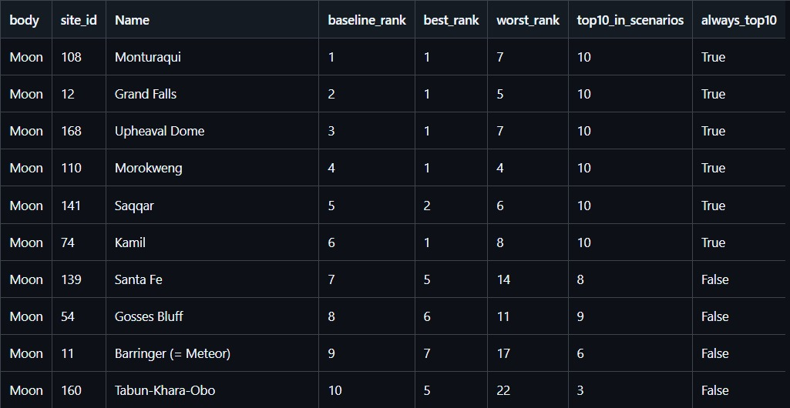 | 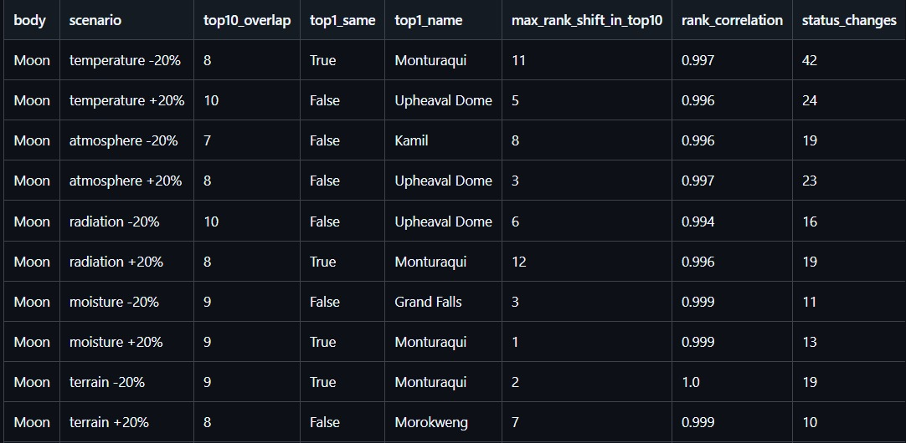 |

## Limitations

- Earth never reaches the Moon's or Mars's extremes in temperature, pressure and UV, so the results show the closest match, not an equal one. The Moon and Mars lists also overlap.
- The weights and the 10% / 20% cutoffs are our own choices and can be adjusted.
- Almost every site is an impact crater, so comparing different terrain types is not meaningful.

## Repository Structure

```
.
├── knn_analogs.py                  # Ranks all sites for Moon and Mars, adds status and warnings
├── validating_the_data.py          # Tests how the results change when weights move by 20%
├── Earths_Locations_clean.csv      # Cleaned Earth sites (187 rows)
├── moon_mars_reference_clean.csv   # Moon and Mars reference conditions
├── all_results.csv                 # Every site, both bodies
├── top10_results.csv               # Top 10 per body
├── results.json                    # Full results for the app
├── validation_summary.csv          # One row per weight test
├── validation_site_stability.csv   # Best and worst rank of each site across tests
├── OUTPUT_FORMAT.md                # Description of the output fields
└── docs/images/                    # Screenshots used in this README
```

## Getting Started

**Requirements:** Python 3 with `numpy` and `pandas`.

```bash
git clone https://github.com/<your-username>/<your-repo>.git
cd <your-repo>
pip install numpy pandas

python knn_analogs.py           # ranking, warnings and result files
python validating_the_data.py   # weight-sensitivity validation
```

Run `knn_analogs.py` first. It prints the top 10 for the Moon and Mars, the cutoff rank and the sanity check, and writes `all_results.csv`, `top10_results.csv` and `results.json`. `validating_the_data.py` then writes the two validation files. Both scripts look for their files in their own folder.

To change the behaviour, edit the settings at the top of `knn_analogs.py`: the group weights, the 10% / 20% limits, the cap and the top-N size.

## Output Format

`results.json` is the main file for the app. Each body (`Moon`, `Mars`) has its reference conditions, a cutoff block (where *Not recommended* starts) and a list of all 187 sites sorted by rank. Each site includes:

| Field | Meaning |
|---|---|
| `rank` | 1 = closest to the body's conditions |
| `name`, `analog_type`, `lat`, `lon` | Site identity and location |
| `distance`, `similarity_score` | Weighted distance and the 0-100 score |
| `status` | `Recommended`, `Acceptable` or `Not recommended` |
| `in_top10` | `true` for ranks 1-10 |
| `warning_level`, `warning_text`, `weak_conditions` | `none`, `caution`, `high` or `n/a`, with the weak conditions |
| `conditions` | The 10 condition values of the site |

See [OUTPUT_FORMAT.md](OUTPUT_FORMAT.md) for the full description. Tip: `warning_level` is the text `n/a` for sites that are not recommended, and some tools (such as pandas) read it as an empty value when loading the CSV files. `results.json` does not have this problem.

## Team

| Area | Team member(s) | Contribution |
|---|---|---|
| Data Cleaning and Research | Myven Bassem, Mona Refaie | Researched and gathered the source data, then cleaned it: fixed the labels, merged duplicate sites and put the Earth and Moon/Mars tables on the same units. |
| Algorithm and Validation | Omar Zamel | Built the kNN ranking, the status labels and the warning system, and validated the results by testing how they change when the weights move by 20%. |
| UI/UX | Sarah Serag | Designed the look and flow of the app, from choosing a target to exploring, comparing and shortlisting sites. |
| App | Abdullah Saad | Developed the Parallax app and brought the ranked results to users. |
| Preparation and Documentation | Myven Bassem, Sarah Serag | Prepared the project materials and wrote the project documentation. |

## Acknowledgements

We would like to thank the **NASA Space Apps Challenge** for the opportunity to work on this challenge and for inspiring this project.

We also thank the **U.S. Geological Survey (USGS)** for the Earth location data that this project builds on.
